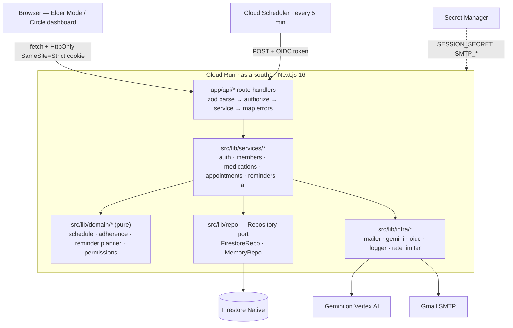

# CareCircle — Elderly Care & Medication Management Platform

**Live app (Cloud Run):** https://carecircle-838093311454.asia-south1.run.app
**Health check:** https://carecircle-838093311454.asia-south1.run.app/api/health

CareCircle is a smart, interconnected healthcare management platform that helps **elderly individuals manage their
daily medications, medical appointments and healthcare routines while keeping their family members and caretakers
informed**. It is a shared ecosystem where elderly individuals, caretakers and family members access and manage an
elderly person's healthcare profile through **secure, passcode-based access** — with the elder at the centre of
their own healthcare decisions.

Built for **PromptWars x Catalyst 2026**.

## The problem

Elderly people often take several medicines a day, at different times, with doctor appointments in between. Family
members and caretakers want to help, but they are often not in the same house. Plain reminder apps only ping one
phone; nobody else knows when a dose is missed, and the elder loses control when relatives "take over".

## What CareCircle does

| Problem statement asks for | How CareCircle does it |
|---|---|
| Shared ecosystem for elder, caretakers, family | One **care profile** per elder. Members have a role (`elder`, `family`, `caretaker`) and a permission (`view` or `manage`). |
| Secure, passcode-based access | Profile code + personal 8-character passcode, `scrypt` hashed, 5 failures → 15 min lockout, signed `HttpOnly` session cookie. Revoke works on the next request. |
| View, add, edit, manage medication schedules | Medication CRUD with times, weekdays, start/end dates and instructions. |
| Track adherence | Doses marked taken / skipped, with **Undo** for 10 s and a "Change" button later; Today grouped by **Morning / Afternoon / Evening / Night** with a progress bar and a "Next dose" card; caregiver summary cards (today taken / missed, next appointment, 7-day rate) and per-medicine bars with text values; 7-day and 30-day adherence per medicine. |
| Monitor upcoming doctor appointments | Appointment CRUD, upcoming list and history, **Add to Google Calendar** link. |
| Proactive email reminders: upcoming doses | Email 15 min before each dose. |
| … missed medications | Email to the elder 30 min after a missed dose; escalation to the care circle at 60 min — **only if the elder allows it**. |
| … medical appointments | Emails 24 h and 2 h before. |
| Beyond a basic reminder app | **One-tap "Mark as taken" link** in emails (no login), **Elder Mode** (large text, high contrast, one big button, read-aloud, Hindi for the daily screens), **Gemini prescription scan** (photo → draft schedule, saved only after a human confirms), **Gemini medicine explainer** in English and Hindi, **"Ask CareCircle" assistant** (type or speak in English, Hindi or a mix: "What is left today?", "I took my morning tablet"; it answers from the profile's own data and proposes one action that a person confirms), **activity log** of who changed what. |
| Elder at the centre | Only the elder adds/revokes members, changes permissions and decides on escalation. |

## Architecture



* `domain/` is pure (no I/O) and never imports `repo/` or `infra/`.
* Services receive their dependencies (repository, mailer, clock, id generator) as arguments, so tests run against
  `MemoryRepo`, a fake mailer and a fixed clock.
* Doses are **computed, not stored**. A dose id is deterministic (`medId_YYYY-MM-DD_HHmm`), so logging twice is an
  idempotent write.
* The reminder engine is a pure function `planReminders(now, snapshot, alreadySent)`. Each run creates the
  `notifications/{sha256(type|target|recipient)}` document **before** sending (create fails if it exists), and deletes
  it if sending fails so the next run retries. Running the cron twice sends nothing new.

## Google services used and where

| Google service | Used for | Where in code |
|---|---|---|
| **Cloud Run** | Hosts the app (Dockerfile, `output: "standalone"`, non-root user) | [`Dockerfile`](Dockerfile), [`next.config.ts`](next.config.ts) |
| **Firestore (Native)** | All data: profiles, members, medications, dose logs, appointments, notifications, activity | [`src/lib/infra/firestore-repo.ts`](src/lib/infra/firestore-repo.ts) |
| **Gemini on Vertex AI** (`@google/genai`, `gemini-3.8-flash`) | Prescription photo → structured JSON draft schedule; plain-language medicine explainer (EN/HI); **"Ask CareCircle" assistant** with a JSON response schema (answer, open a page, mark a dose, draft a medicine or appointment, or refuse medical advice) | [`src/lib/infra/gemini.ts`](src/lib/infra/gemini.ts), [`src/lib/services/ai.ts`](src/lib/services/ai.ts), [`src/lib/services/assist.ts`](src/lib/services/assist.ts) |
| **Cloud Scheduler** | Calls `POST /api/cron/reminders` every 5 min with an **OIDC token** | [`src/app/api/cron/reminders/route.ts`](src/app/api/cron/reminders/route.ts) |
| **Google Auth Library** | Verifies the scheduler's OIDC token (signature, audience, service-account email) | [`src/lib/infra/oidc.ts`](src/lib/infra/oidc.ts) |
| **Secret Manager** | `SESSION_SECRET` (and SMTP credentials) mounted into Cloud Run | deploy command below |
| **IAM** | Dedicated service accounts: `carecircle-run` (only `datastore.user`, `aiplatform.user`, `secretmanager.secretAccessor`) and `carecircle-scheduler` (OIDC identity) | deploy commands below |
| **Cloud Build + Artifact Registry** | `gcloud run deploy --source .` builds the image | — |
| **Cloud Logging** | Structured JSON logs with `severity` (no personal data) | [`src/lib/infra/logger.ts`](src/lib/infra/logger.ts) |
| **Gmail (SMTP)** | Reminder emails via Nodemailer | [`src/lib/infra/mailer.ts`](src/lib/infra/mailer.ts) |
| **Google Calendar** | "Add to Google Calendar" template link for each appointment | [`src/lib/services/appointments.ts`](src/lib/services/appointments.ts) |

Application Default Credentials are used everywhere on Cloud Run — there is no key file in the repo or image.

## Evaluation criteria → evidence

| Criterion | Evidence |
|---|---|
| **Code quality** | Layered design (domain / services / repo / infra / routes); TypeScript `strict` + `noUncheckedIndexedAccess`; ESLint (`next/core-web-vitals`, `typescript`, full `jsx-a11y` recommended) with zero warnings; Prettier; small focused modules; one `authorize` table ([`permissions.ts`](src/lib/domain/permissions.ts)). |
| **Security** | `scrypt` + per-member salt + `timingSafeEqual` ([`passcode.ts`](src/lib/security/passcode.ts)); HMAC tokens with per-purpose keys ([`tokens.ts`](src/lib/security/tokens.ts)); lockout in a Firestore transaction; same error for unknown profile and wrong passcode plus dummy hashing; `HttpOnly; Secure; SameSite=Strict` cookie; Origin check on every write ([`http.ts`](src/lib/server/http.ts)); zod validation with length limits on every input ([`schemas.ts`](src/lib/domain/schemas.ts)); OIDC-verified cron; POST-only one-tap link so mail scanners cannot mark doses; CSP, HSTS, `X-Frame-Options`, `nosniff`, `Referrer-Policy`, `Permissions-Policy` ([`next.config.ts`](next.config.ts)); HTML-escaped emails; passcode reset logs out the member's other sessions (session version in the token); rate limits on login, profile creation, AI and dose links keyed by the proxy-appended client address (spoofing `X-Forwarded-For` does not bypass them, verified on Cloud Run); at most 30 reminder emails per recipient per day, and every email says how to stop it; least-privilege service account; secrets only in Secret Manager; no personal data in logs. |
| **Efficiency** | Doses computed on the fly (no write amplification); one Firestore read set per profile per cron run, profiles processed in bounded parallel batches of 5; cached explainer answers; lazy Firestore import; standalone Next.js output on a small Alpine image; `min-instances 0`. |
| **Testing** | 256 Vitest tests: table-driven domain tests (time zones, midnight boundary, end-dated and non-daily medicines, revoked members, two runs in the same minute), token tamper/expiry tests, service integration tests with `MemoryRepo` + fixed clock, route-handler tests (login, lockout, CSRF, CRUD, cron auth, one-tap link, AI routes, passcode reset, rate-limit spoofing, Undo, assistant route) and component tests with **axe-core**. Assistant tests cover every intent, malformed JSON, an unknown dose, a view-only member asking for a write, a medical-advice question and an injected "ignore your rules" request. A colour test parses the CSS tokens and checks 7:1 for text and 3:1 for controls in both modes ([`tests/contrast.test.ts`](tests/contrast.test.ts)). Coverage on `src/lib`: **94.8 % lines**. CI: [`.github/workflows/ci.yml`](.github/workflows/ci.yml). |
| **Accessibility** | Researched elder-first design (see "Design decisions and evidence" below): 19 px base text, Elder Mode 22 px on the root element so every size scales, text colour pairs ≥ 7:1 (WCAG AAA) and control borders ≥ 3:1 checked by a unit test; 48 px targets (60 px in Elder Mode, main button 64 px, full width); labelled bottom tab bar on phones, no hamburger; one visible toast that is also the single `aria-live` region, with **Undo** instead of confirmation dialogs; GOV.UK-style error summary that takes focus and links to each field; skip link; one `h1` per page; landmarks; visible focus ring; `progressbar` with values; SVG icon + word for every state (no colour-only meaning); read-aloud via Speech Synthesis; assistant replies in an `aria-live` area and its confirm card takes focus; Hindi for navigation, Today, the assistant and the explainer, `lang` on `<html>`, 1.7 line height for Devanagari; no horizontal scroll at 320 px; `prefers-reduced-motion`. Tests: [`tests/components.test.tsx`](tests/components.test.tsx), [`tests/assistant.test.tsx`](tests/assistant.test.tsx), [`tests/contrast.test.ts`](tests/contrast.test.ts). |
| **Problem statement alignment** | Every sentence of the challenge maps to a feature — see the table above and acceptance rows R1–R12 in [`docs/DESIGN.md`](docs/DESIGN.md). |
| **Google services** | Cloud Run, Firestore, Gemini on Vertex AI, Cloud Scheduler (OIDC), Secret Manager, IAM, Cloud Build, Artifact Registry, Cloud Logging, Gmail, Google Calendar — see the table above. |

## Design decisions and evidence

| Finding | Source | What CareCircle does |
|---|---|---|
| Body text of 19 px suits most readers; plain words, short sentences, no italics | [NHS design system: typography](https://service-manual.nhs.uk/design-system/styles/typography), [ODPHP Health Literacy Online](https://health.gov/healthliteracyonline/) | 19 px base, 22 px in Elder Mode, line height 1.5 (1.7 for Hindi), short labels |
| Enhanced text contrast 7:1, controls 3:1 | WCAG 2.2 [1.4.6](https://www.w3.org/WAI/WCAG22/Understanding/contrast-enhanced), [1.4.11](https://www.w3.org/WAI/WCAG22/Understanding/non-text-contrast) | Colour tokens checked by [`tests/contrast.test.ts`](tests/contrast.test.ts) in both modes |
| Older adults tap best on targets larger than about 14 mm | [Leitão & Silva, target and spacing sizes for older adults](https://mural.maynoothuniversity.ie/6045) and its 2017 follow-up | 48 px minimum, 60 px in Elder Mode, the main "I took it" button 64 px and full width |
| Hidden menus cut discoverability; icons need visible text labels | NN/g: [hamburger menus](https://www.nngroup.com/articles/hamburger-menus/), [icon usability](https://www.nngroup.com/articles/icon-usability/) | Bottom tab bar with icon + word on phones, top bar on wide screens |
| Prefer undo to "Are you sure?" dialogs for routine actions | [NN/g: confirmation dialogs](https://www.nngroup.com/articles/confirmation-dialog/) | "Taken" shows at once with who and when; the toast offers Undo for 10 s |
| Seniors struggle with fiddly widgets; errors must say how to fix them | [NN/g: usability for seniors](https://www.nngroup.com/articles/usability-for-senior-citizens/), GOV.UK [error message](https://design-system.service.gov.uk/components/error-message/) and [error summary](https://design-system.service.gov.uk/components/error-summary/) | Time-of-day chips plus typed times; error summary with links, errors under each field |
| Caregivers want "was it taken?" at a glance; too many alerts become noise | [Medisafe on its Medfriend caregiver feature](https://medisafe.com/education-resources/the-impact-of-medisafes-medfriend-caregiver-feature-on-adherence) | Circle summary cards; escalation only after 60 min and only if the elder allows it; no streaks or shaming words |
| Never use colour alone | WCAG 2.2 [1.4.1](https://www.w3.org/WAI/WCAG22/Understanding/use-of-color) | Every state is an icon and a word |

Decided against: dark mode (dark text on light suits ageing eyes), web fonts (CSP `font-src 'self'`, page weight), any UI library.

### "Ask CareCircle" assistant: how it stays safe

* Gemini sees only a snapshot of the member's own profile (today's doses, active medicines, next 3 appointments) and the request, marked as data, not instructions.
* Gemini must return JSON in a fixed schema. The server validates it with zod, then checks it against the snapshot and the member's permission: a dose id that is not in today's list, or a write from a view-only member, becomes a plain answer. If Gemini errors or times out, or returns bad JSON, the assistant gives a friendly "please try again" answer (never a 500) and every normal button and form keeps working.
* **The assistant never writes.** Marking a dose shows a confirm card (medicine, dosage and time from our own data) with Yes / No; Yes uses the normal `POST /api/doses`, so Undo works the same. A new medicine or appointment opens the normal form pre-filled, saved only when a person presses Save.
* Medical-advice questions ("can I take two tablets?") get a refusal that always ends with "Ask your doctor or pharmacist".

## Run locally

```bash
npm ci
cp .env.example .env      # set SESSION_SECRET to 32+ random characters; DATA_STORE=memory needs no cloud
npm run dev               # http://localhost:3005
```

With `DATA_STORE=firestore` and `gcloud auth application-default login`, the app uses your Firestore and Vertex AI.

## Test and check

```bash
npm run lint
npm run typecheck
npm test
npm run test:coverage
```

Trigger the reminder run locally (only works off Cloud Run, when `CRON_DEV_KEY` is set in `.env`):

```bash
curl -X POST -H "x-cron-key: $CRON_DEV_KEY" http://localhost:3005/api/cron/reminders
```

## Deploy (Google Cloud)

Scripts: [`scripts/gcp-setup.sh`](scripts/gcp-setup.sh) (APIs, Firestore, service accounts, IAM roles, `SESSION_SECRET` in Secret Manager) and [`scripts/deploy.sh`](scripts/deploy.sh) (Cloud Build source deploy to Cloud Run plus the OIDC Scheduler job). The equivalent commands:

```bash
gcloud run deploy carecircle --source . --region asia-south1 --allow-unauthenticated \
  --service-account carecircle-run@PROJECT.iam.gserviceaccount.com \
  --set-secrets SESSION_SECRET=SESSION_SECRET:latest \
  --set-env-vars APP_URL=https://SERVICE_URL,DATA_STORE=firestore,GOOGLE_CLOUD_PROJECT=PROJECT,GOOGLE_CLOUD_LOCATION=global,GEMINI_MODEL=gemini-3.8-flash,CRON_INVOKER_EMAIL=carecircle-scheduler@PROJECT.iam.gserviceaccount.com

gcloud scheduler jobs create http carecircle-reminders --location asia-south1 \
  --schedule "*/5 * * * *" --http-method POST \
  --uri https://SERVICE_URL/api/cron/reminders \
  --oidc-service-account-email carecircle-scheduler@PROJECT.iam.gserviceaccount.com \
  --oidc-token-audience https://SERVICE_URL/api/cron/reminders
```

## Real vs simulated (honest notes)

* **Real:** Cloud Run hosting, Firestore storage, Gemini on Vertex AI, Cloud Scheduler with OIDC, Secret Manager,
  scrypt passcodes, lockout, reminder planning and idempotency.
* **Email:** real Gmail SMTP when `SMTP_USER` / `SMTP_PASS` are configured — the live deployment sends real email (credentials in Secret Manager; verified with a live missed-dose reminder). Without them the mailer runs in
  **dry-run mode**: it logs that an email would be sent (type only, no address or content) and the rest of the
  flow — including idempotency — runs unchanged.
* **Hindi** covers navigation, the today view, status messages, the assistant and the Gemini explainer. Forms, the circle page and emails are English.
* **Voice input** for the assistant uses the browser's own speech recognition (Web Speech API, `hi-IN` / `en-IN`). It works in Chrome and Edge; the microphone button is hidden where the browser does not support it, and typing always works. Speech is processed by the browser vendor, not by CareCircle.
* **Rate limiting** is in memory per Cloud Run instance. It slows abuse but is not a global limit; the Firestore
  login lockout is the durable control.
* **CSP** allows `'unsafe-inline'` scripts because Next.js injects small inline bootstrap scripts; there is no
  third-party script on any page.
* **Coverage** excludes the two thin cloud adapters (`firestore-repo.ts`, `gemini.ts`); their logic is covered through
  the same `Repository` / `TextModel` interfaces with in-memory fakes.
* **AI output is never trusted:** Gemini drafts are validated with zod and shown in the normal form; nothing is saved
  until a person presses **Confirm and save**. Every AI text ends with "This is not medical advice. Ask your doctor or
  pharmacist."
* CareCircle is a hackathon project, **not a medical device**.
