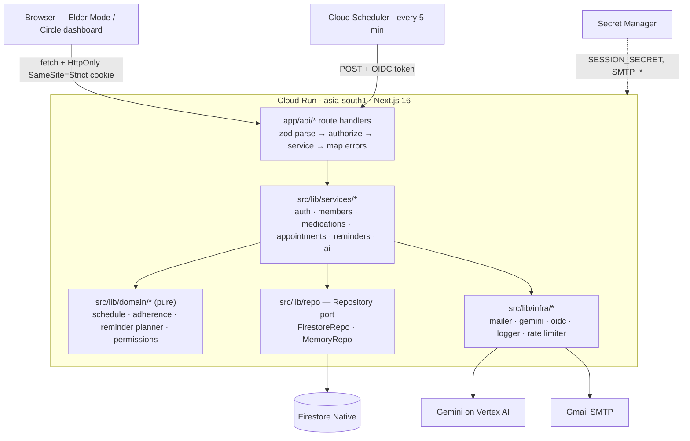

# CareCircle — Elderly Care & Medication Management Platform

**Live app (Cloud Run):** https://carecircle-838093311454.asia-south1.run.app
**Health check:** https://carecircle-838093311454.asia-south1.run.app/api/health

CareCircle is a smart, interconnected healthcare management platform that helps **elderly individuals manage their
daily medications, medical appointments and healthcare routines while keeping their family members and caretakers
informed**. It is a shared ecosystem where elderly individuals, caretakers and family members access and manage an
elderly person's healthcare profile through **secure, passcode-based access** — with the elder at the centre of
their own healthcare decisions.

Built for **PromptWars x Catalyst 2026**.

## The problem

Elderly people often take several medicines a day, at different times, with doctor appointments in between. Family
members and caretakers want to help, but they are often not in the same house. Plain reminder apps only ping one
phone; nobody else knows when a dose is missed, and the elder loses control when relatives "take over".

## What CareCircle does

| Problem statement asks for | How CareCircle does it |
|---|---|
| Shared ecosystem for elder, caretakers, family | One **care profile** per elder. Members have a role (`elder`, `family`, `caretaker`) and a permission (`view` or `manage`). |
| Secure, passcode-based access | Profile code + personal 8-character passcode, `scrypt` hashed, 5 failures → 15 min lockout, signed `HttpOnly` session cookie. Revoke works on the next request. |
| View, add, edit, manage medication schedules | Medication CRUD with times, weekdays, start/end dates and instructions. |
| Track adherence | Doses marked taken / skipped; today view with *taken / due / missed / upcoming*; 7-day and 30-day adherence per medicine. |
| Monitor upcoming doctor appointments | Appointment CRUD, upcoming list and history, **Add to Google Calendar** link. |
| Proactive email reminders: upcoming doses | Email 15 min before each dose. |
| … missed medications | Email to the elder 30 min after a missed dose; escalation to the care circle at 60 min — **only if the elder allows it**. |
| … medical appointments | Emails 24 h and 2 h before. |
| Beyond a basic reminder app | **One-tap "Mark as taken" link** in emails (no login), **Elder Mode** (large text, high contrast, one big button, read-aloud, Hindi), **Gemini prescription scan** (photo → draft schedule, saved only after a human confirms), **Gemini medicine explainer** in English and Hindi, **activity log** of who changed what. |
| Elder at the centre | Only the elder adds/revokes members, changes permissions and decides on escalation. |

## Architecture



* `domain/` is pure (no I/O) and never imports `repo/` or `infra/`.
* Services receive their dependencies (repository, mailer, clock, id generator) as arguments, so tests run against
  `MemoryRepo`, a fake mailer and a fixed clock.
* Doses are **computed, not stored**. A dose id is deterministic (`medId_YYYY-MM-DD_HHmm`), so logging twice is an
  idempotent write.
* The reminder engine is a pure function `planReminders(now, snapshot, alreadySent)`. Each run creates the
  `notifications/{sha256(type|target|recipient)}` document **before** sending (create fails if it exists), and deletes
  it if sending fails so the next run retries. Running the cron twice sends nothing new.

## Google services used and where

| Google service | Used for | Where in code |
|---|---|---|
| **Cloud Run** | Hosts the app (Dockerfile, `output: "standalone"`, non-root user) | [`Dockerfile`](Dockerfile), [`next.config.ts`](next.config.ts) |
| **Firestore (Native)** | All data: profiles, members, medications, dose logs, appointments, notifications, activity | [`src/lib/infra/firestore-repo.ts`](src/lib/infra/firestore-repo.ts) |
| **Gemini on Vertex AI** (`@google/genai`, `gemini-3.8-flash`) | Prescription photo → structured JSON draft schedule; plain-language medicine explainer (EN/HI) | [`src/lib/infra/gemini.ts`](src/lib/infra/gemini.ts), [`src/lib/services/ai.ts`](src/lib/services/ai.ts) |
| **Cloud Scheduler** | Calls `POST /api/cron/reminders` every 5 min with an **OIDC token** | [`src/app/api/cron/reminders/route.ts`](src/app/api/cron/reminders/route.ts) |
| **Google Auth Library** | Verifies the scheduler's OIDC token (signature, audience, service-account email) | [`src/lib/infra/oidc.ts`](src/lib/infra/oidc.ts) |
| **Secret Manager** | `SESSION_SECRET` (and SMTP credentials) mounted into Cloud Run | deploy command below |
| **IAM** | Dedicated service accounts: `carecircle-run` (only `datastore.user`, `aiplatform.user`, `secretmanager.secretAccessor`) and `carecircle-scheduler` (OIDC identity) | deploy commands below |
| **Cloud Build + Artifact Registry** | `gcloud run deploy --source .` builds the image | — |
| **Cloud Logging** | Structured JSON logs with `severity` (no personal data) | [`src/lib/infra/logger.ts`](src/lib/infra/logger.ts) |
| **Gmail (SMTP)** | Reminder emails via Nodemailer | [`src/lib/infra/mailer.ts`](src/lib/infra/mailer.ts) |
| **Google Calendar** | "Add to Google Calendar" template link for each appointment | [`src/lib/services/appointments.ts`](src/lib/services/appointments.ts) |

Application Default Credentials are used everywhere on Cloud Run — there is no key file in the repo or image.

## Evaluation criteria → evidence

| Criterion | Evidence |
|---|---|
| **Code quality** | Layered design (domain / services / repo / infra / routes); TypeScript `strict` + `noUncheckedIndexedAccess`; ESLint (`next/core-web-vitals`, `typescript`, full `jsx-a11y` recommended) with zero warnings; Prettier; small focused modules; one `authorize` table ([`permissions.ts`](src/lib/domain/permissions.ts)). |
| **Security** | `scrypt` + per-member salt + `timingSafeEqual` ([`passcode.ts`](src/lib/security/passcode.ts)); HMAC tokens with per-purpose keys ([`tokens.ts`](src/lib/security/tokens.ts)); lockout in a Firestore transaction; same error for unknown profile and wrong passcode plus dummy hashing; `HttpOnly; Secure; SameSite=Strict` cookie; Origin check on every write ([`http.ts`](src/lib/server/http.ts)); zod validation with length limits on every input ([`schemas.ts`](src/lib/domain/schemas.ts)); OIDC-verified cron; POST-only one-tap link so mail scanners cannot mark doses; CSP, HSTS, `X-Frame-Options`, `nosniff`, `Referrer-Policy`, `Permissions-Policy` ([`next.config.ts`](next.config.ts)); HTML-escaped emails; rate limits on login, AI and dose links; least-privilege service account; secrets only in Secret Manager; no personal data in logs. |
| **Efficiency** | Doses computed on the fly (no write amplification); one Firestore read set per profile per cron run; cached explainer answers; lazy Firestore import; standalone Next.js output on a small Alpine image; `min-instances 0`. |
| **Testing** | 167 Vitest tests: table-driven domain tests (time zones, midnight boundary, end-dated and non-daily medicines, revoked members, two runs in the same minute), token tamper/expiry tests, service integration tests with `MemoryRepo` + fixed clock, route-handler tests (login, lockout, CSRF, CRUD, cron auth, one-tap link) and component tests with **axe-core**. Coverage on `src/lib`: **94 % lines**. CI: [`.github/workflows/ci.yml`](.github/workflows/ci.yml). |
| **Accessibility** | Elder Mode (20 px base, ≥ 7:1 contrast, 56 px targets, one big button per dose); skip link; one `h1` per page; landmarks; visible focus ring; `aria-live` status for "Marked as taken"; every input labelled with errors linked by `aria-describedby`; icon + text for every state (no colour-only meaning); read-aloud via Speech Synthesis; Hindi UI with correct `lang`; `prefers-reduced-motion`. Tests: [`tests/components.test.tsx`](tests/components.test.tsx). |
| **Problem statement alignment** | Every sentence of the challenge maps to a feature — see the table above and acceptance rows R1–R12 in [`docs/DESIGN.md`](docs/DESIGN.md). |
| **Google services** | Cloud Run, Firestore, Gemini on Vertex AI, Cloud Scheduler (OIDC), Secret Manager, IAM, Cloud Build, Artifact Registry, Cloud Logging, Gmail, Google Calendar — see the table above. |

## Run locally

```bash
npm ci
cp .env.example .env      # set SESSION_SECRET to 32+ random characters; DATA_STORE=memory needs no cloud
npm run dev               # http://localhost:3005
```

With `DATA_STORE=firestore` and `gcloud auth application-default login`, the app uses your Firestore and Vertex AI.

## Test and check

```bash
npm run lint
npm run typecheck
npm test
npm run test:coverage
```

Trigger the reminder run locally (only works off Cloud Run, when `CRON_DEV_KEY` is set in `.env`):

```bash
curl -X POST -H "x-cron-key: $CRON_DEV_KEY" http://localhost:3005/api/cron/reminders
```

## Deploy (Google Cloud)

```bash
gcloud run deploy carecircle --source . --region asia-south1 --allow-unauthenticated \
  --service-account carecircle-run@PROJECT.iam.gserviceaccount.com \
  --set-secrets SESSION_SECRET=SESSION_SECRET:latest \
  --set-env-vars APP_URL=https://SERVICE_URL,DATA_STORE=firestore,GOOGLE_CLOUD_PROJECT=PROJECT,GOOGLE_CLOUD_LOCATION=global,GEMINI_MODEL=gemini-3.8-flash,CRON_INVOKER_EMAIL=carecircle-scheduler@PROJECT.iam.gserviceaccount.com

gcloud scheduler jobs create http carecircle-reminders --location asia-south1 \
  --schedule "*/5 * * * *" --http-method POST \
  --uri https://SERVICE_URL/api/cron/reminders \
  --oidc-service-account-email carecircle-scheduler@PROJECT.iam.gserviceaccount.com \
  --oidc-token-audience https://SERVICE_URL/api/cron/reminders
```

## Real vs simulated (honest notes)

* **Real:** Cloud Run hosting, Firestore storage, Gemini on Vertex AI, Cloud Scheduler with OIDC, Secret Manager,
  scrypt passcodes, lockout, reminder planning and idempotency.
* **Email:** real Gmail SMTP when `SMTP_USER` / `SMTP_PASS` are configured. Without them the mailer runs in
  **dry-run mode**: it logs that an email would be sent (type only, no address or content) and the rest of the
  flow — including idempotency — runs unchanged.
* **Rate limiting** is in memory per Cloud Run instance. It slows abuse but is not a global limit; the Firestore
  login lockout is the durable control.
* **CSP** allows `'unsafe-inline'` scripts because Next.js injects small inline bootstrap scripts; there is no
  third-party script on any page.
* **Coverage** excludes the two thin cloud adapters (`firestore-repo.ts`, `gemini.ts`); their logic is covered through
  the same `Repository` / `TextModel` interfaces with in-memory fakes.
* **AI output is never trusted:** Gemini drafts are validated with zod and shown in the normal form; nothing is saved
  until a person presses **Confirm and save**. Every AI text ends with "This is not medical advice. Ask your doctor or
  pharmacist."
* CareCircle is a hackathon project, **not a medical device**.
